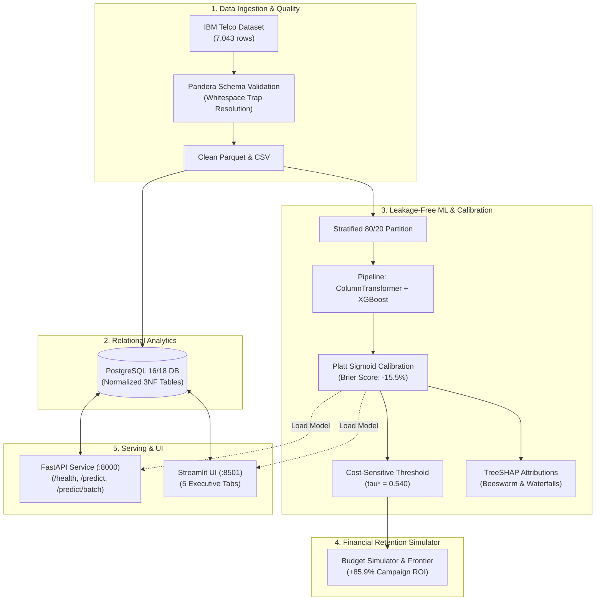

# Customer Churn Intelligence & Retention Optimization Platform

[](https://www.python.org/)
[](https://www.postgresql.org/)
[](https://fastapi.tiangolo.com/)
[](https://streamlit.io/)
[](docker-compose.yml)
[](tests/)
[](https://github.com/yashbanedar/Customer-Churn-Intelligence-Retention-Platform/actions/workflows/ci.yml)

An enterprise-grade **Customer Churn Intelligence and Retention Optimization Platform** built on the IBM Telco Churn dataset. Demonstrates leakage-safe ML pipelines, Platt probability calibration, cost-sensitive threshold optimization, Explainable AI (SHAP), a normalized 3NF PostgreSQL schema, and an executive financial retention budget simulator.

---

## 📌 Architecture Overview



---

## 🌟 Key Highlights & Business Impact

- **Leakage-Safe Machine Learning**: Strict `ColumnTransformer` + `Pipeline` preventing data leakage during preprocessing.
- **Calibrated Probabilities**: Platt scaling drops Brier Score by **-15.5%** and ECE by **-68.3%**, moving from raw scores to genuine empirical probabilities.
- **Cost-Sensitive Decision Boundary**: Replaced naive 0.5 threshold with optimal $\tau^* = 0.540$, achieving **+$119.00 net savings lift** on held-out test data.
- **Explainable AI (SHAP)**: Global feature attributions and local waterfall explanations for high-risk, borderline, and loyal accounts.
- **Financial Retention Budget Simulator**: What-If financial simulator modeling optimal customer prioritization, delivering **+85.9% campaign ROI** under budget constraints.
- **Production FastAPI Microservice**: Type-safe REST endpoints with Pydantic v2 schemas and Swagger documentation (`/docs`).
- **Executive Streamlit Dashboard**: 5 interactive tabs with live KPI analytics, model benchmarks, scoring sandbox, and budget curves.
- **Enterprise Testing & CI/CD**: 81 automated Pytest unit and integration tests running on GitHub Actions.

---

## 📊 Model Benchmarks (Held-out Test Set, $N=1,409$)

| Model Architecture | PR-AUC | ROC-AUC | F1 Score | Precision | Recall | Brier Score | Status |
| :--- | :-: | :-: | :-: | :-: | :-: | :-: | :--- |
| **Logistic Regression** | 0.6325 | 0.8415 | 0.6136 | 0.5043 | 0.7834 | 0.1687 | Baseline |
| **Random Forest** | 0.6532 | 0.8409 | 0.6358 | 0.5325 | 0.7888 | 0.1609 | Standard |
| **XGBoost** | **0.6623** | **0.8445** | **0.6372** | **0.5333** | **0.7914** | **0.1361\*** | ⭐ **Champion** |

*\*Post-calibration with 5-fold CV Platt Sigmoid scaling.*

---

## 📂 Repository Layout

```text
├── api/                    # FastAPI microservice & Pydantic v2 schemas
├── app/                    # Streamlit Executive Dashboard UI & components
├── artifacts/              # Model pipelines, metrics JSON, SHAP explainers & figures
├── data/                   # Processed datasets and standardized sample JSON payloads
├── docs/                   # Architecture, Deployment, Environment & Causal guides
├── sql/                    # Normalized PostgreSQL 3NF schema and analytics queries
├── src/
│   ├── business/           # Cost matrix, threshold optimizer & budget simulator
│   ├── data/               # Ingestion, Pandera validation & database loader
│   ├── eda/                # Statistical tests & exploratory data analysis
│   ├── models/             # ColumnTransformer, training, calibration & SHAP
│   └── config.py           # Pydantic Settings configuration
├── tests/                  # 81 automated Pytest unit and integration tests
├── docker-compose.yml      # Multi-container orchestration (PostgreSQL, API, UI)
└── requirements.txt        # Pinned dependencies for Python 3.13
```

---

## ⚡ Quickstart

### 1. Clone & Setup Environment
```bash
git clone https://github.com/yashbanedar/Customer-Churn-Intelligence-Retention-Platform.git
cd Customer-Churn-Intelligence-Retention-Platform

python -m venv .venv
# Windows:
.\.venv\Scripts\Activate.ps1
# Linux / macOS:
source .venv/bin/activate

pip install -r requirements.txt
```

### 2. Run Data Pipeline & Model Training
```bash
# Data ingestion & Pandera validation
python -m src.data.pipeline

# Train models & calibrate probabilities
python -m src.models.train_models
python -m src.models.run_phase5
python -m src.business.run_retention_simulator
```

### 3. Launch Services
```bash
# Start FastAPI Service (Swagger at http://localhost:8000/docs)
uvicorn api.main:app --host 0.0.0.0 --port 8000 --reload

# Start Streamlit Dashboard (UI at http://localhost:8501)
streamlit run app/dashboard.py
```

### 4. Or Run with Docker Compose
```bash
docker compose up --build -d
```

### 5. Run Test Suite (81 Tests)
```bash
pytest -v
```

---

## 📖 Deep-Dive Documentation

- 🏛️ [System Architecture Specification](docs/ARCHITECTURE.md)
- 🚀 [Deployment & Cloud Operations Guide](docs/DEPLOYMENT_GUIDE.md)
- ⚙️ [Environment Variables Guide](docs/ENVIRONMENT_VARIABLES.md)
- ⚖️ [Probability Calibration & Causal Uncertainty](docs/PROBABILITY_AND_CAUSAL_UNCERTAINTY.md)
- 📊 [Data Source & Relational Schema Reference](docs/DATA_SOURCE_AND_SCHEMA.md)

---

## 📄 License
This project is licensed under the MIT License.
