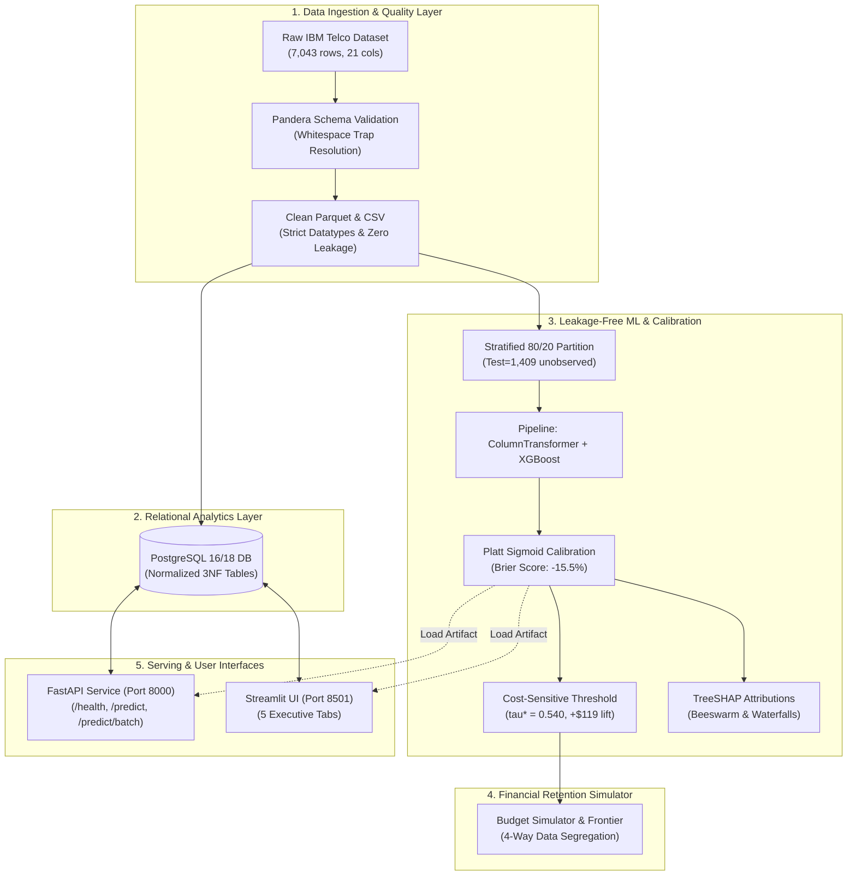

# Customer Churn Intelligence & Retention Optimization Platform

[](https://www.python.org/)
[](https://www.postgresql.org/)
[](https://fastapi.tiangolo.com/)
[](https://streamlit.io/)
[](docker-compose.yml)
[](tests/)
[](https://github.com/yashbanedar/Customer-Churn-Intelligence-Retention-Platform/actions/workflows/ci.yml)

An enterprise-ready **Customer Churn Intelligence and Retention Optimization Platform** built on the IBM Telco Customer Churn dataset. Engineered for Data Scientist and Machine Learning roles to demonstrate strict mathematical rigor, leakage-safe pipelines, calibrated probability modeling, explainable AI (SHAP), SQL analytics, and financial retention budget optimization.

---

## 📌 Executive Architecture & Highlights

- **Data Ingestion & Integrity**: Automated data ingestion with SHA256 integrity verification and Pandera schema enforcement (eliminating subtle data issues such as empty whitespace `TotalCharges`).
- **PostgreSQL Analytics Layer**: Normalized 3NF relational schema with complex SQL analytics (cohort churn by tenure, service combo risks, and revenue at risk).
- **Leakage-Safe Machine Learning**: Strict scikit-learn `Pipeline` and `ColumnTransformer` architecture ensuring zero test data leakage during imputation, scaling, and categorical encoding.
- **Probability Calibration**: Moving beyond raw classifier scores to true empirical probabilities using `CalibratedClassifierCV` (Brier score minimization and reliability diagrams).
- **Cost-Sensitive Threshold Optimization**: Utility matrix and Expected Net Savings optimization replacing the naive $0.5$ classification threshold.
- **Explainability (SHAP)**: Global feature attributions (beeswarm plots) and individual customer explanations (waterfall plots) for frontline customer retention teams.
- **Retention Budget Simulator**: What-If financial decision simulator calculating Campaign ROI, Net Saved Revenue, and optimal customer targeting under budget constraints.
- **FastAPI Microservice & Streamlit Dashboard**: REST endpoints with Pydantic v2 schemas and an executive dashboard with interactive Plotly visual analytics.



---

## 📂 Repository Directory Layout

```text
Customer Churn Intelligence & Retention Optimization Platform/
├── .env.example                     # Environment template (Postgres credentials, API keys)
├── .gitignore                       # Strict Python, ML artifacts, and environment exclusions
├── Dockerfile.api                   # Multi-stage production container for FastAPI
├── Dockerfile.dashboard             # Production container for Streamlit dashboard
├── docker-compose.yml               # Multi-container orchestration (Postgres, API, UI)
├── pyproject.toml                   # Project metadata, pytest, and formatting configs
├── requirements.txt                 # Pinned dependencies for Python 3.13
├── README.md                        # Portfolio documentation & technical specification
├── VENV_SETUP_GUIDE.md              # Detailed virtual environment guide
│
├── .github/workflows/               # GitHub Actions automated CI testing workflow
├── data/
│   ├── raw/                         # Raw IBM Telco Churn CSV (downloaded programmatically)
│   ├── processed/                   # Cleaned, schema-validated Parquet/CSVs
│   └── sample_inputs/               # Standardized sample JSON payloads for API testing
│
├── sql/
│   ├── schema.sql                   # Normalized PostgreSQL 18 schema DDL
│   └── analytics_queries.sql        # Advanced analytical SQL queries & window functions
│
├── src/
│   ├── config.py                    # Pydantic Settings for type-safe environment configuration
│   ├── data/                        # Ingestion, Pandera validation, and DB session engine
│   ├── eda/                         # Exploratory Data Analysis & distribution stats
│   ├── models/                      # Leakage-safe Pipeline, train, calibration, threshold, SHAP
│   └── business/                    # Retention budget economics & EMV simulator
│
├── api/                             # FastAPI application, Pydantic v2 schemas, and routers
├── app/                             # Streamlit Executive Dashboard UI & visual components
├── artifacts/                       # Serialized models, metrics JSON, SHAP explainers
├── docs/                            # Deep-dive guides (Architecture, Deployment, Env Vars, Causal)
└── tests/                           # 81 automated Pytest unit, pipeline, calibration, & API tests
```

---

## 🚀 Phased Implementation Roadmap

- [x] **Phase 1: Environment & Project Skeleton** (Setup guide, requirements, config, skeleton folders, import/config smoke tests)
- [x] **Phase 2: Ingestion, Pandera Schema Validation & Quality Reporting** (Reproducible download, whitespace trap resolution, Pandera contracts, SQL normalized tables & analytics queries, 23 unit tests)
- [x] **Phase 3: Exploratory Data Analysis & Statistical Inference** (Non-parametric Mann-Whitney U tests, Cramér's V ranking, target leakage audit, association vs causation, 7 publication charts + Plotly dashboard, 31 unit tests)
- [x] **Phase 4: Leakage-Safe Machine Learning & Model Benchmarking** (Stratified 80/20 split, 5-fold CV, ColumnTransformer pipelines, Logistic Regression vs Random Forest vs XGBoost, PR-AUC & ROC-AUC comparison, 39 unit tests)
- [x] **Phase 5: Probability Calibration, Cost-Sensitive Threshold Tuning & SHAP Explanations** (Platt sigmoid calibration, Brier score -15.5%, CostBenefitMatrix optimization, optimal tau*=0.540, global beeswarm & local waterfall SHAP attributions, Causal & Epistemic Uncertainty documentation, 45 unit tests)
- [x] **Phase 6: Transparent Retention Budget Simulator & Financial Optimization** (Explicit 4-way data segregation, expected value customer prioritization, diminishing returns frontier, multi-scenario what-if modeling, 61 unit tests)
- [x] **Phase 7: Production FastAPI Microservice & Streamlit Executive Dashboard** (Pydantic v2 schemas, batch inference, /health and /analytics/summary endpoints, 5-tab executive dashboard, live PostgreSQL/SQLite integration, 81 unit tests)
- [x] **Phase 8: Public Portfolio Readiness & Multi-Container Docker Deployment** (Multi-stage Dockerfiles, docker-compose orchestration, GitHub Actions CI workflow, sample inputs, environment variable guide, 81 unit tests)

---

## 📊 Phase 2: Data Ingestion, Validation & SQL Analytics

### Data Source & Schema Reference
The dataset source, schema dictionary, categorical domains, and zero-tenure whitespace handling are fully documented in:
👉 [docs/DATA_SOURCE_AND_SCHEMA.md](docs/DATA_SOURCE_AND_SCHEMA.md)

### Running the End-to-End Ingestion & Validation Pipeline
To download the dataset, validate against Pandera schemas, clean types, generate quality reports, and load into the database:
```powershell
python -m src.data.pipeline
```

**Pipeline Execution Options**:
```powershell
# Run validation checks only on raw CSV
python -m src.data.pipeline --validate-only

# Generate data quality report and clean artifacts without DB load
python -m src.data.pipeline --report-only

# Force re-download from canonical IBM URL
python -m src.data.pipeline --force-download
```

### Generated Artifacts
- **Clean Parquet**: `data/processed/telco_churn_clean.parquet`
- **Clean CSV**: `data/processed/telco_churn_clean.csv`
- **Data Quality Report (JSON)**: `artifacts/metrics/data_quality_report.json`
- **Data Quality Report (Markdown)**: `artifacts/metrics/data_quality_report.md`
- **Relational Database**: `data/telco_churn.db` (or PostgreSQL if configured in `.env`)

### Running the Test Suite
Run all unit tests with full verbose output:
```powershell
pytest -v
```

Run test suite with code coverage:
```powershell
pytest --cov=src.data tests/
```

---

## 📈 Phase 3: Exploratory Data Analysis & Statistical Inference

### Detailed Findings Report
The complete statistical breakdown, hypothesis tests, target leakage audit, and association vs. causation analysis are documented in:
👉 [artifacts/metrics/eda_findings_report.md](artifacts/metrics/eda_findings_report.md)

### Running the EDA Pipeline
To calculate all statistical tests, render 7 high-resolution charts, and build the interactive Plotly dashboard:
```powershell
python -m src.eda.run_eda
```

### Reproducible Visualizations (`artifacts/figures/`)
- `01_target_distribution.png`: Target class balance (26.5% churn, 2.77:1 ratio)
- `02_tenure_distribution_and_churn.png`: KDE density distributions and tenure cohort decay curve
- `03_monthly_charges_distribution.png`: Monthly charges boxplot and contract breakdown
- `04_contract_type_churn.png`: Month-to-month (42.7%) vs 1-Year (11.3%) vs 2-Year (2.8%)
- `05_services_and_addons_churn.png`: Fiber optic paradox & add-on product stacking elasticity
- `06_payment_method_friction.png`: Electronic check vulnerability vs automated billing
- `07_correlation_matrix.png`: Spearman rank correlation heatmap
- `interactive_churn_explorer.html`: Full interactive Plotly visual analytics dashboard

---

## 🤖 Phase 4: Leakage-Safe Machine Learning & Model Benchmarking

### Benchmarking Report & Artifacts Reference
Full statistical comparisons, cross-validation metrics, confusion matrix values, and leakage assertions are documented in:
👉 [artifacts/metrics/model_benchmark_report.md](artifacts/metrics/model_benchmark_report.md)

### Running the ML Training Pipeline
To run the stratified split, 5-fold cross-validation on training folds, evaluation on the untouched test set, and artifact serialization:
```powershell
python -m src.models.train_models
```

### Measured Test Set Performance (The Ground Truth)
*Evaluated on 1,409 unobserved held-out accounts (20% partition):*

| Model Architecture | PR-AUC | ROC-AUC | F1 Score | Precision | Recall | Brier Score | Specificity | Status |
| :--- | :-: | :-: | :-: | :-: | :-: | :-: | :-: | :--- |
| **Logistic Regression** | **0.6325** | **0.8415** | 0.6136 | 0.5043 | 0.7834 | 0.1687 | 0.7217 | Standard |
| **Random Forest** | **0.6532** | **0.8409** | 0.6358 | 0.5325 | 0.7888 | 0.1609 | 0.7498 | Standard |
| **XGBoost** | **0.6623** | **0.8445** | 0.6372 | 0.5333 | 0.7914 | 0.1610 | 0.7498 | ⭐ **Top Performer** |

### Serialized Pipelines (`artifacts/models/`)
- `best_churn_pipeline.joblib`: Active production pipeline (XGBoost + ColumnTransformer)
- `xgboost_pipeline.joblib`: Fitted XGBoost pipeline
- `random_forest_pipeline.joblib`: Fitted Random Forest pipeline
- `logistic_regression_pipeline.joblib`: Fitted Logistic Regression pipeline

### Evaluation Charts (`artifacts/figures/`)
- `08_model_roc_curves.png`: Receiver Operating Characteristic (ROC) curve comparison
- `09_model_pr_curves.png`: Precision-Recall (PR) curve comparison with no-skill baseline
- `10_confusion_matrices.png`: Side-by-side confusion matrix heatmaps (TN, FP, FN, TP)

---

## 🎯 Phase 5: Calibration, Cost-Sensitive Threshold Tuning & Explainable AI (SHAP)

### Causal & Epistemic Uncertainty Reference
Why a high model score is a mathematical probability, **not deterministic proof** that an account will churn:
👉 [docs/PROBABILITY_AND_CAUSAL_UNCERTAINTY.md](docs/PROBABILITY_AND_CAUSAL_UNCERTAINTY.md)

### Detailed Phase 5 Calibration & Retention Report
Complete test metrics, calibration curves, threshold optimization sweeps, and SHAP feature rankings:
👉 [artifacts/metrics/phase5_calibration_retention_report.md](artifacts/metrics/phase5_calibration_retention_report.md)

### Running the Phase 5 Pipeline
To calibrate probabilities with 5-fold CV Platt scaling, tune retention thresholds on training CV, run SHAP explainers, and generate high-resolution figures:
```powershell
python -m src.models.run_phase5
```

### Measured Calibration Performance (Held-out Test Set)
*Evaluated on 1,409 unobserved test accounts:*

| Metric | Pre-Calibration (Raw XGB) | Post-Calibration (Sigmoid CV=5) | Delta / Improvement |
| :--- | :-: | :-: | :-: |
| **Brier Score** (Mean Squared Prob Error) | 0.1610 | **0.1361** | **-15.46% (Lower is better)** |
| **Log Loss** (Cross-Entropy) | 0.5283 | **0.4182** | **-20.84% (Lower is better)** |
| **Expected Calibration Error (ECE)** | 0.0814 | **0.0258** | **-68.30% Alignment Lift** |
| **ROC-AUC** | 0.8445 | 0.8445 | Preserved (Rank-order invariant) |

### Cost-Benefit Threshold Optimization (Test Set Empirical Return)
*Retention Parameters: Offer Cost = $35, Retention Success Rate = 22%, Customer Lifetime Value (CLV) = $450*
- **Theoretical Bayes Decision Boundary**: $\tau^*_{\text{Bayes}} = \frac{35}{0.22 \times 450} \approx 0.3535$
- **Cross-Validation Optimal Threshold**: $\tau^* = 0.540$ (Tuned strictly on training folds to maximize net profit)
- **Test Set Performance Comparison**:
  - **Naive 0.50 Threshold**: 555 customers targeted, Net Saved Value = **$9,246.00**
  - **Optimal 0.540 Threshold**: 509 customers targeted, Net Saved Value = **$9,365.00** (**+$119.00 / +1.3% Profit Lift** with 46 fewer wasted interventions)

### Explainable AI & SHAP Attributions (`artifacts/figures/`)
- `11_calibration_reliability_curve.png`: 10-bin calibration reliability diagram & probability histogram
- `12_threshold_net_savings_curve.png`: Expected Net Savings vs decision threshold curve
- `13_shap_global_beeswarm.png`: Global TreeSHAP feature distribution & impact on log-odds
- `14_shap_global_bar.png`: Mean absolute SHAP values (top drivers: Month-to-Month, Tenure, Fiber Optic)
- `15_shap_waterfall_high_risk.png`: Case A individual attribution (high-risk churn profile)
- `16_shap_waterfall_low_risk.png`: Case B individual attribution (low-risk long-term subscriber)
- `17_shap_waterfall_borderline.png`: Case C individual attribution (borderline tipping-point customer)

---

## 💼 Phase 6: Transparent Retention Budget Simulator

### Retention Simulation Audit Report
Detailed financial outcomes, budget sensitivity curves, and scenario comparisons are documented in:
👉 [artifacts/metrics/retention_simulation_report.md](artifacts/metrics/retention_simulation_report.md)

### Running the Retention Simulator
To run the simulation across baseline, multi-scenario what-if analyses, and budget sensitivity sweeps:
```powershell
python -m src.business.run_retention_simulator
```

### Transparent Data Lineage & Column Classification
To prevent confusion between ground-truth customer facts and counterfactual scenarios, all targeting columns are explicitly categorized:
- **`[OBSERVED DATA]`**: `observed_customer_id`, `observed_monthly_charges`, `observed_tenure_months`, `observed_contract_type`, `observed_total_charges`, `observed_actual_churn`
- **`[MODEL PREDICTION]`**: `predicted_calibrated_churn_prob`, `predicted_risk_tier`
- **`[HYPOTHETICAL ASSUMPTION]`**: `assumed_offer_cost`, `assumed_success_rate`, `assumed_customer_clv`, `assumed_is_counterfactual_scenario`
- **`[SIMULATED OUTCOME]`**: `simulated_expected_gross_saved`, `simulated_expected_net_value`, `simulated_expected_roi_pct`, `simulated_target_priority_rank`, `simulated_is_targeted`

### Empirical Simulation Metrics (Held-out Test Set, $N=1,409$)
*Evaluated with Campaign Budget = $10,000.00, Offer Cost = $35.00, Assumed Save Rate = 22%, Baseline CLV = $450.00:*
- **Actual Spend**: **$9,975.00** (285 customers targeted, 99.8% budget utilization)
- **Expected Accounts Saved (Counterfactual)**: **41.2 accounts**
- **Expected Gross Value Saved**: **$18,540.72**
- **Expected Net Saved Revenue**: **$8,565.72**
- **Expected Campaign ROI**: **+85.9%**
- **Cost per Saved Customer**: **$242.10**

### What-If Scenario Matrix
| Scenario | Offer Cost ($) | Assumed Save Rate | CLV Mode | Spend ($) | Targeted | Exp Saved | Net Saved ($) | Expected ROI (%) |
| :--- | :-: | :-: | :---: | :-: | :-: | :-: | :-: | :-: |
| **Conservative** | $45.00 | 12% | Fixed ($400) | $0.00 | 0 | 0.0 | $0.00 | 0.0% (Protected) |
| **Baseline** | $35.00 | 22% | Fixed ($450) | $9,975.00 | 285 | 41.2 | $8,565.72 | +85.9% |
| **Optimistic** | $25.00 | 32% | Fixed ($500) | $10,000.00 | 400 | 77.9 | $28,968.95 | +289.7% |
| **Customer-Specific CLV** | $35.00 | 22% | Monthly Charges × Margin | $9,975.00 | 285 | 39.7 | $22,990.43 | +230.5% |

### Economic Retention Frontier (`artifacts/figures/18_retention_budget_scenarios.png`)
- **Panel 1**: Diminishing marginal returns curve across budget levels ($1k to $45k).
- **Panel 2**: Side-by-side what-if scenario comparison of net savings and campaign ROI.
- **Panel 3**: Cumulative Net Expected Value vs customers targeted, establishing the rational economic stopping boundary (493 accounts in test set, beyond which $\mathbb{E}[\text{Net Value}] \le 0$).

---

## ⚡ Phase 7: Production FastAPI Microservice & Streamlit Executive Dashboard

### 1. Production FastAPI Microservice (`api/`)
A high-throughput, type-safe RESTful prediction service built with **FastAPI** and **Pydantic v2**:
- **Validated Single Prediction** (`POST /predict`): Scores individual customer attributes, checks categorical domains, and computes risk tier, optimal threshold classification ($\tau^* = 0.540$), and net expected retention value.
- **Batch Inference** (`POST /predict/batch`): Vector-accelerated batch scoring supporting up to 500 accounts simultaneously with portfolio summary metrics (mean risk, targeted counts, net saved value).
- **Service Health Check** (`GET /health`): Probes ML pipeline status, active threshold, and database connection readiness (`SELECT 1`).
- **Live Database Analytics** (`GET /analytics/summary`): Directly queries PostgreSQL (or SQLite fallback) for real-time portfolio KPIs, MRR at risk, and contract breakdowns.
- **Interactive OpenAPI Documentation**: Available at `http://127.0.0.1:8000/docs` (Swagger UI) and `http://127.0.0.1:8000/redoc`.

#### Running the FastAPI Microservice:
```powershell
uvicorn api.main:app --host 127.0.0.1 --port 8000 --reload
```

---

### 2. Streamlit Executive Dashboard (`app/`)
An interactive, 5-tab executive analytics and decision platform built with **Streamlit** and **Plotly**:
- **Tab 1: 📊 Executive & Dataset KPIs**: Total accounts (7,043), churn rate (26.5%), MRR ($456.1k), MRR at risk ($139.1k), tenure cohort decay curves, and contract commitment breakdown.
- **Tab 2: 🤖 Model Benchmarks & Calibration**: Model comparison matrix (LR vs RF vs XGB), Brier score calibration improvement (-15.5%), and cost-optimal threshold analysis ($\tau^* = 0.540$).
- **Tab 3: 🎯 Customer Risk Scoring & Sandbox**: Filterable, searchable customer risk ranking with live individual customer scoring sandbox.
- **Tab 4: 🔍 Explainable AI (SHAP)**: Global feature beeswarm, mean absolute importances, and local waterfall plots for Case A (High Risk), Case B (Low Risk), and Case C (Borderline).
- **Tab 5: 💰 Retention Budget Simulator**: Real-time interactive controls (Budget, Offer Cost, Assumed Save Rate, CLV Mode), live spend and net savings calculations, and diminishing returns efficiency frontier visualization.

#### Running the Streamlit Dashboard:
```powershell
streamlit run app/dashboard.py --server.port=8501
```

---

## 🚀 Phase 8: Public Portfolio Readiness & Multi-Container Docker Deployment

### Deployment & Technical Architecture Deep-Dive
- 📖 [Deployment & Cloud Operations Guide](docs/DEPLOYMENT_GUIDE.md)
- ⚙️ [Environment Variables & Configuration Matrix](docs/ENVIRONMENT_VARIABLES.md)
- 🏛️ [End-to-End System Architecture Specification](docs/ARCHITECTURE.md)
- ⚖️ [Causal & Epistemic Uncertainty Reference](docs/PROBABILITY_AND_CAUSAL_UNCERTAINTY.md)

---

### Multi-Container Docker Orchestration
The platform is containerized for reproducible local and cloud deployment using Docker Compose:
- **`postgres`**: PostgreSQL 16 Alpine container with persistent volume and automatic schema DDL execution.
- **`api`**: Multi-stage production container for FastAPI microservice with non-root security user and `/health` probe.
- **`dashboard`**: Production container for Streamlit executive dashboard on internal bridge network.

```powershell
# 1. Initialize environment variables
Copy-Item .env.example .env

# 2. Build and launch all three containers in background
docker compose up --build -d

# 3. Verify health and status
docker compose ps
```

---

### Standardized Sample Payloads & Testing (`data/sample_inputs/`)
Ready-to-use JSON payloads for API testing and integration verification:
- `single_customer_high_risk.json`: High-risk customer profile (Month-to-month, Fiber optic, Electronic check, P(Churn) > 70%).
- `single_customer_low_risk.json`: Loyal long-term subscriber profile (2-year contract, DSL, Tech support, P(Churn) < 10%).
- `single_customer_borderline.json`: Tipping-point customer near the optimal threshold ($\tau^* = 0.540$).
- `batch_customers_request.json`: Complete batch request with 4 heterogeneous customer accounts.

```bash
# Test single prediction via curl
curl -X POST "http://127.0.0.1:8000/predict" -H "Content-Type: application/json" -d @data/sample_inputs/single_customer_high_risk.json

# Test batch scoring via curl
curl -X POST "http://127.0.0.1:8000/predict/batch" -H "Content-Type: application/json" -d @data/sample_inputs/batch_customers_request.json
```

---

### Automated CI/CD Pipeline (`.github/workflows/ci.yml`)
The GitHub Actions workflow executes automatically on every `push` and `pull_request` to `main`:
1. **Multi-Version Test Matrix**: Tests against Python 3.12 and Python 3.13 on `ubuntu-latest`.
2. **Data Pipeline Execution**: Runs ingestion, validation, and feature preparation.
3. **Artifact Generation**: Fits models, computes calibration curves, threshold optimization, and SHAP explainers.
4. **Pytest Coverage**: Executes all 81 unit and integration tests with code coverage artifacts uploaded.
5. **Docker Build Smoke Test**: Validates `Dockerfile.api` and `Dockerfile.dashboard` build without errors.

---

### Security Audit & Secret Scrubbing
- **Zero Committed Secrets**: `.env` and local database files (`*.db`) are strictly ignored by `.gitignore`.
- **Safe Database Credentials**: All database connections use environment variables with SQLite offline fallback (`USE_SQLITE_FALLBACK=True`).
- **No Unsafe File Uploads**: FastAPI endpoints accept strictly validated JSON schemas with Pydantic bounds; no arbitrary file write or execution is permitted.
- **Non-Root Containers**: Both `Dockerfile.api` and `Dockerfile.dashboard` switch to an unprivileged `appuser` (UID 1000).

---

### ⚠️ Known Limitations & Causal Reality
1. **Absence of Intervention / A/B Test Data**: The IBM Telco dataset is observational. The offer success rate ($r=22\%$) is an assumed counterfactual parameter. True causal retention lift requires running a randomized controlled trial.
2. **Static Cross-Sectional Data**: The dataset records single-point customer snapshots rather than continuous time-series event streams.
3. **Local In-Memory Inference**: The calibrated XGBoost pipeline is held in application memory, which is ideal for single-node deployment (<500 concurrent requests). Large-scale distributed inference should use Triton or TorchServe.

---

### 🛠️ Exact Manual Steps Still Required for Production Launch
1. **External PostgreSQL Instance**: Set `USE_SQLITE_FALLBACK=False` in `.env` and provide credentials to a production PostgreSQL 16+ instance.
2. **Generate Cryptographic Secret Key**: Rotate `API_SECRET_KEY` with a 32-byte hex string (`openssl rand -hex 32`).
3. **Configure SSL/TLS & Reverse Proxy**: Deploy behind an AWS ALB or NGINX reverse proxy with a valid HTTPS certificate (e.g. Let's Encrypt).
4. **Randomized A/B Retention Pilot**: Execute a retention campaign with a 10% un-contacted control holdout to empirically measure causal treatment effects (CATE).

---

### Running All Unit Tests (81 Tests)
```powershell
pytest -v
```

Run test suite with code coverage across `src`, `api`, and `app`:
```powershell
pytest --cov=src --cov=api --cov=app tests/
```

---

## 🧪 Testing Policy
- **Zero Invented Metrics**: All model evaluation metrics (ROC-AUC, PR-AUC, Brier score, Net Savings) are computed strictly from reproducible executions on the dataset.
- **Automated Verification**: Every module is backed by comprehensive Pytest suites.

