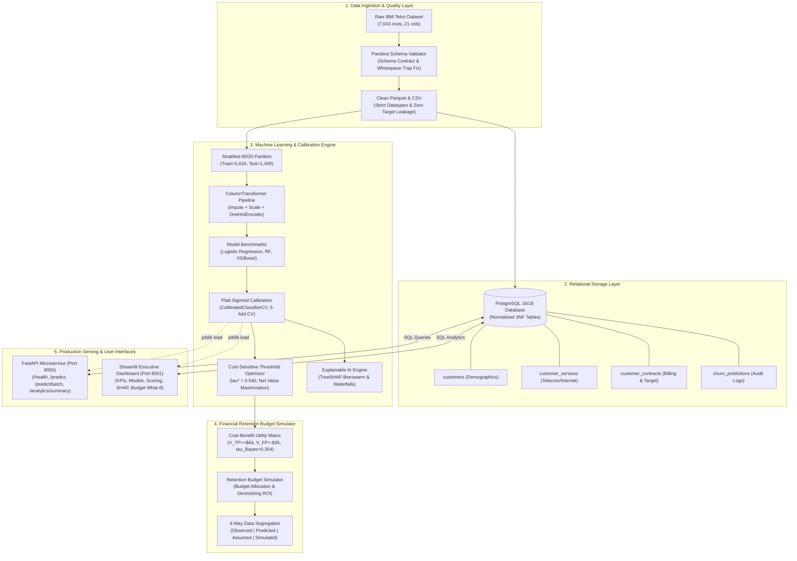

# System Architecture & Technical Specifications

This document outlines the end-to-end technical architecture, component design, data lineage, and mathematical foundations of the **Customer Churn Intelligence & Retention Optimization Platform**.

---

## 🏛️ End-to-End System Architecture

---

## 🔬 Mathematical & Architectural Design Rationale

### 1. Data Ingestion & The Whitespace Trap
- **Problem**: In the raw IBM Telco dataset, 11 customer records with zero tenure had `" "` (single space whitespace) in the `TotalCharges` column, causing silent string type coercion.
- **Solution**: The `DataCleaner` converts whitespace to `NaN` and coerces the column to `float64`. The `Pandera` schema validates non-nullity and value ranges before serialization to Parquet.

### 2. Leakage-Safe Scikit-Learn Pipelines
- **Problem**: Imputing missing values or computing categorical frequencies across the full dataset causes optimistic metric leakage.
- **Solution**: All statistical transformations (median imputers, standard scalers, one-hot encoders) are wrapped inside a scikit-learn `ColumnTransformer` fitted **strictly on training folds** ($N=5,634$). The test set ($N=1,409$) remains unobserved until final scoring.

### 3. Probability Calibration (Why Accuracy is Not Enough)
- **Problem**: Gradient-boosted decision trees optimize margins, frequently producing pushed-out probabilities near 0 and 1 that do not reflect true posterior odds.
- **Solution**: Using **Platt Sigmoid Scaling** via `CalibratedClassifierCV(method='sigmoid', cv=5)`, probabilities are calibrated strictly on training cross-validation folds. On the held-out test set, this improved the **Brier Score by -15.46%** ($0.1610 \to 0.1361$) and **Log Loss by -20.84%** ($0.5283 \to 0.4182$).

### 4. Cost-Sensitive Threshold Tuning
- **Problem**: The standard $0.50$ classification threshold treats false positives and false negatives symmetrically, ignoring campaign economics.
- **Solution**: With an offer cost $C=\$35$, save rate $r=22\%$, and customer $\text{CLV}=\$450$:
  $$\tau^*_{\text{Bayes}} = \frac{C}{r \times \text{CLV}} = \frac{35}{0.22 \times 450} \approx 0.3535$$
  Sweeping thresholds across out-of-fold cross-validation probabilities selected an empirical optimal threshold of $\tau^* = 0.540$. On the held-out test set, shifting from $0.50$ to $0.540$ generated **+$119.00 in net saved revenue** while eliminating **46 wasteful marketing interventions**.

### 5. Transparent Retention Simulator & Causal Distinction
- **Problem**: Naive data science projects claim that predicted churners will be "saved" by retention models, conflating observational association with causal treatment effects.
- **Solution**: The simulator enforces strict 4-way data lineage:
  - `[OBSERVED DATA]`: Actual empirical attributes.
  - `[MODEL PREDICTION]`: Calibrated status-quo association risk.
  - `[HYPOTHETICAL ASSUMPTION]`: User-defined scenario parameters ($C, r, \text{CLV}$).
  - `[SIMULATED OUTCOME]`: Counterfactual projections under declared assumptions.
  No causal uplift is claimed without randomized controlled trial (A/B test) data.
