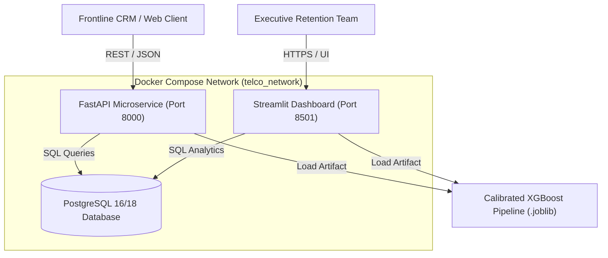

# Production Deployment & Operations Guide

This guide details the deployment, container orchestration, database initialization, and cloud infrastructure setup for the **Customer Churn Intelligence & Retention Optimization Platform**.

---

## 🏗️ Deployment Architecture

The platform is designed around a three-tier microservice architecture:
1. **Database Layer**: PostgreSQL 16/18 with normalized 3NF relational schemas, primary/foreign keys, and analytics indexes (with SQLite local fallback).
2. **Serving Layer**: FastAPI asynchronous ASGI microservice running under Uvicorn with Pydantic v2 input validation, calibrated probability inference, and `/health` monitoring.
3. **Executive Layer**: Streamlit interactive executive dashboard communicating with PostgreSQL and model pipelines for real-time risk prioritization and budget simulation.



---

## 🐳 Option 1: Local Docker Compose Deployment (Recommended)

Docker Compose orchestrates the PostgreSQL database, FastAPI service, and Streamlit dashboard on an isolated bridge network with automated health checks.

### Prerequisites
- Docker Engine $\ge 24.0$
- Docker Compose $\ge 2.20$

### 1. Configure Environment
```bash
cp .env.example .env
```
*(Verify `.env` has `USE_SQLITE_FALLBACK=False` when running inside Docker so services connect to the `postgres` container).*

### 2. Build and Launch Containers
```bash
docker compose up --build -d
```

### 3. Verify Container Health
```bash
docker compose ps
```
Expected output:
```text
NAME                     IMAGE                      STATUS                   PORTS
telco_churn_postgres     postgres:16-alpine         Up (healthy)             0.0.0.0:5432->5432/tcp
telco_churn_api          telco-churn-api:latest     Up (healthy)             0.0.0.0:8000->8000/tcp
telco_churn_dashboard    telco-dashboard:latest     Up (healthy)             0.0.0.0:8501->8501/tcp
```

### 4. Access Live Services
- **FastAPI Documentation**: `http://localhost:8000/docs`
- **FastAPI Health Check**: `http://localhost:8000/health`
- **Streamlit Executive Dashboard**: `http://localhost:8501`

### 5. Tear Down & Volume Management
```bash
# Stop containers preserving database volume
docker compose down

# Stop containers and purge all database volume data
docker compose down -v
```

---

## 🖥️ Option 2: Standalone Local Deployment (Python Virtual Environment)

For local development or environments without Docker:

### 1. Activate Virtual Environment
```powershell
.\.venv\Scripts\Activate.ps1
```

### 2. Seed Database (SQLite or Local PostgreSQL)
```powershell
# Ingests, validates, cleans, and seeds tables in data/telco_churn.db
python -m src.data.pipeline
```

### 3. Start FastAPI Microservice (Terminal 1)
```powershell
uvicorn api.main:app --host 127.0.0.1 --port 8000 --reload
```

### 4. Start Streamlit Dashboard (Terminal 2)
```powershell
streamlit run app/dashboard.py --server.port=8501
```

---

## ☁️ Option 3: Cloud Production Deployment

### A. AWS Deployment (ECS Fargate + RDS PostgreSQL)
1. **Relational Database**:
   - Provision an **Amazon RDS for PostgreSQL** (db.t4g.micro or db.t4g.small) in a private VPC subnet.
   - Run `sql/schema.sql` via psql or bastion host to initialize the normalized tables.
2. **Container Registry**:
   - Push `Dockerfile.api` and `Dockerfile.dashboard` images to **Amazon ECR**.
3. **ECS Task Definitions**:
   - Create two ECS service tasks (one for API, one for Dashboard) running on AWS Fargate.
   - Inject database credentials securely from **AWS Secrets Manager**.
4. **Load Balancing & SSL**:
   - Provision an **Application Load Balancer (ALB)** with an AWS Certificate Manager (ACM) TLS certificate.
   - Route `/api/*` to FastAPI target group and `/*` to Streamlit target group.

### B. Render / Railway Deployment
1. Provision a managed **PostgreSQL** instance on Railway or Render.
2. Deploy the FastAPI service using `Dockerfile.api`.
3. Set environment variables:
   - `DATABASE_URL`: Connection string provided by managed database.
   - `USE_SQLITE_FALLBACK`: `False`.
4. Deploy the Streamlit dashboard using `Dockerfile.dashboard` pointing to the API URL.

---

## 🔒 Production Security Checklist

- [ ] **Rotate Secret Keys**: Generate a strong cryptographic key for `API_SECRET_KEY` using `openssl rand -hex 32`.
- [ ] **Database Credentials**: Never use default passwords (`postgres:postgres`) in public environments. Store credentials in AWS Secrets Manager or cloud vault.
- [ ] **TLS / HTTPS**: Enforce HTTPS for all external traffic. Never transmit customer records over plain HTTP.
- [ ] **CORS Restrictions**: In `api/main.py`, restrict `allow_origins=["*"]` to the exact production domain of the Streamlit dashboard or corporate web app.
- [ ] **Rate Limiting**: Configure reverse proxy rate limiting (e.g. NGINX `limit_req_zone` or Cloudflare) to prevent brute-force inference attacks.

---

## ⚠️ Known Limitations & Assumptions

1. **Observational vs. Causal Uplift**: The underlying dataset contains historical observational customer records. It has **no randomized controlled trial (A/B test)** data. The campaign save rate ($r$) is a hypothetical simulation parameter, not an observed treatment effect (CATE).
2. **Static Snapshot Data**: The dataset represents single-point-in-time account records. Continuous real-time production inference requires event-driven feature stores (e.g. Feast) tracking daily billing events and network usage.
3. **In-Memory Model Loading**: The model pipeline is held in application memory. High-concurrency enterprise deployments (>1,000 req/sec) should use model serving frameworks like Triton or TorchServe.

---

## 🛠️ Exact Manual Steps Still Required for Public Launch

Before declaring this application live in a public production environment:
1. **Provision Production Database**: Connect a live PostgreSQL 16+ instance and execute `python -m src.data.pipeline` to seed production tables.
2. **Configure Custom Domain & DNS**: Map domain records (e.g., `churn-api.yourcompany.com` and `churn.yourcompany.com`) to the load balancer.
3. **Acquire SSL/TLS Certificates**: Issue trusted certificates via Let's Encrypt or AWS ACM.
4. **Run Live A/B Experiment**: Conduct a randomized retention pilot with a 10% holdout group to measure empirical causal lift before scaling retention budgets.
