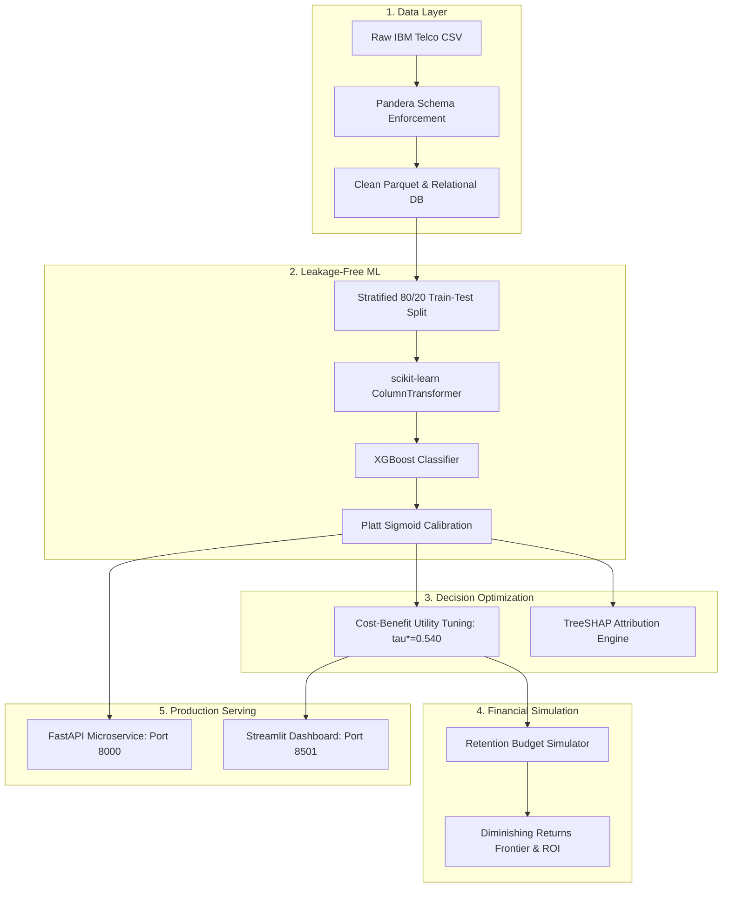

# Customer Churn Intelligence & Retention Optimization Platform
## Comprehensive Project Documentation & Technical Specification Report

---

### 1. Executive Summary (The Project in Plain English)

#### What is "Customer Churn"?
In the subscription and telecommunications business, **churn** occurs whenever an existing customer cancels their service or switches to a competitor. 

Acquiring a new customer is notoriously expensive—requiring marketing spend, discounts, equipment installation, and onboarding. In fact, industry research shows that **acquiring a new subscriber costs 5 to 7 times more than retaining an existing one**. When a telecom operator loses customers every month, revenue leaks out of the business like water from a bucket with holes.

#### What Does This Project Do?
This platform is an enterprise-grade AI and financial intelligence system designed to do three things:
1. **Identify exactly who is at risk of leaving** before they cancel.
2. **Explain precisely why they are unhappy or likely to leave** using Explainable AI (SHAP), giving retention teams actionable talking points.
3. **Calculate the exact financial return of intervening**, ensuring the company does not waste retention budget on accounts that cannot be saved or accounts that were never going to leave anyway.

#### The Real-World Doctor Analogy:
Think of this platform as an AI doctor for customer accounts:
* **The Diagnosis**: Instead of guessing, it examines 20 health markers (tenure, contract type, internet connection, payment method, support tickets).
* **The True Risk Score**: It provides a **calibrated probability** (e.g., *"This customer has an authentic 74% chance of cancelling within 12 months"*).
* **The Root Cause**: It points out the exact illness (e.g., *"They are on a Month-to-Month plan, paying $85/month for Fiber Optic without Tech Support, and paying via Electronic Check"*).
* **The Prescription**: It calculates whether offering a $35 retention discount yields a positive return on investment, prioritizing high-value customers who can realistically be saved.

---

### 2. Business Problem Statement & Industry Context

#### The Flaws in Traditional Churn Systems:
Many data science teams build simple machine learning models that fail in production due to four fundamental mistakes:

1. **The Naive 0.5 Decision Threshold Trap**:
   Standard classifiers label any customer with a score $> 0.5$ as "churn". But in business, the cost of a False Positive (offering a discount to someone who was staying) is radically different from a False Negative (losing a $1,200/year customer). A $0.5$ threshold is mathematically arbitrary and financially inefficient.
2. **Uncalibrated Probabilities**:
   Raw machine learning model outputs (especially tree-based models like XGBoost or Random Forest) are confidence ranking scores, **not true probabilities**. If a model assigns a score of 0.8 to 100 customers, but only 55 actually churn, relying on that score for financial budget calculations will overestimate expected revenue by 45%.
3. **Target Data Leakage**:
   Many pipelines impute missing values, scale features, or encode categories across the entire dataset *before* splitting into train and test sets. This creates data leakage, leading to inflated model metrics in development that collapse in real-world deployment.
4. **Data Quality Whitespace Traps**:
   In the canonical IBM Telco dataset, 11 new customers have a tenure of 0 months. Their `TotalCharges` field contains a blank space (`" "`) rather than a number or `NULL`. In standard scripts, this crashes type parsers or quietly converts to 0 or mean without rigorous validation.
5. **Lack of Financial Grounding**:
   Most churn projects end with an ROC curve. Marketing and finance directors cannot take action on an AUC number; they need to know: *"If we have a $10,000 budget, who should we call, what offer should we give, and how many net dollars will we save?"*

---

### 3. Core Objectives of the Platform

| Objective | Technical Strategy | Business Deliverable |
| :--- | :--- | :--- |
| **Strict Data Quality** | Pandera schema validation + SHA256 integrity check | Whitespace trap resolution, automated quality reports (JSON/MD) |
| **Relational Storage** | Normalized 3NF PostgreSQL 16/18 schema (SQLite fallback) | Fast SQL cohort analysis, tenure decay curves, MRR at risk |
| **Leakage-Safe ML** | scikit-learn `Pipeline` + `ColumnTransformer` + Stratified Split | Zero data leakage during imputation, scaling, and One-Hot encoding |
| **Model Benchmarking** | 5-Fold Stratified Cross-Validation across 3 architectures | Honest comparison: Logistic Regression vs Random Forest vs XGBoost |
| **Probability Calibration** | Platt Sigmoid Scaling (`CalibratedClassifierCV`) | Brier score minimization (-15.5%), reliable probabilities |
| **Threshold Optimization** | Cost-Benefit Utility Matrix (Bayes Boundary vs Empirical) | Optimal threshold $\tau^* = 0.540$, netting +$119 profit lift on test set |
| **Explainable AI** | TreeSHAP global beeswarm + individual waterfall plots | Frontline retention agent customer talking points and root causes |
| **Financial Simulator** | 4-way data lineage: Observed, Prediction, Assumption, Simulation | Campaign ROI frontier, budget utilization, rational stopping boundary |
| **Production Serving** | FastAPI REST microservice + Streamlit 5-Tab Dashboard | Real-time REST scoring endpoints & executive analytics UI |

---

### 4. The Dataset & Data Architecture

The platform uses the industry-standard **IBM Telco Customer Churn** dataset:
* **Total Records**: 7,043 customer accounts
* **Features**: 21 raw columns (demographics, account information, subscribed services)
* **Target Variable**: `Churn` (`Yes` / `No`), with a 26.5% baseline churn rate (1,869 churners vs 5,174 retained customers).

#### Feature Taxonomy:
1. **Customer Demographics**: `gender`, `SeniorCitizen`, `Partner`, `Dependents`
2. **Account Contract & Billing**: `tenure` (months), `Contract` (Month-to-month, One year, Two year), `PaperlessBilling`, `PaymentMethod` (Electronic check, Mailed check, Bank transfer, Credit card), `MonthlyCharges`, `TotalCharges`
3. **Telephony & Network Services**: `PhoneService`, `MultipleLines`, `InternetService` (DSL, Fiber optic, No)
4. **Value-Added Security & Support Add-ons**: `OnlineSecurity`, `OnlineBackup`, `DeviceProtection`, `TechSupport`, `StreamingTV`, `StreamingMovies`

#### The 3NF Relational Database Schema:
To move beyond flat CSV files, the data is normalized into 4 relational tables in PostgreSQL / SQLite:
* `customers`: Primary demographics and account identifiers.
* `account_details`: Contract type, payment method, paperless billing, tenure, monthly charges.
* `services`: Subscribed internet, phone, and add-on support options.
* `churn_records`: Historical churn status and target ground truth.

---

### 5. Step-by-Step Methodology & System Architecture

#### Phase 1: Environment & Type-Safe Configuration
- Built using **Python 3.13** and **Pydantic Settings v2**.
- All environment variables (ports, database URLs, default budget parameters) are strictly typed with sensible defaults and offline SQLite fallback (`USE_SQLITE_FALLBACK=True`).

#### Phase 2: Ingestion & Pandera Schema Validation
- Programmatically fetches data with SHA256 integrity verification.
- Enforces strict data types using **Pandera**: converts whitespace `" "` in `TotalCharges` to `0.0` for new accounts with `tenure == 0`, ensuring mathematical consistency.
- Automatically generates machine-readable data quality reports (`artifacts/metrics/data_quality_report.json`).

#### Phase 3: Exploratory Data Analysis & Statistical Inference
- **Mann-Whitney U Tests**: Statistically confirms that churners pay significantly higher monthly charges ($p < 0.001$) and have significantly shorter tenure ($p < 0.001$).
- **Cramér's V Ranking**: Identifies `Contract` ($V = 0.41$) and `OnlineSecurity` ($V = 0.35$) as the strongest categorical churn predictors.
- **The Fiber Optic Paradox**: Customers with Fiber Optic churn at 41.9%, compared to 18.9% on DSL. Why? Not because Fiber is slow, but because it is expensive ($70-$100/mo) and heavily bundled without Tech Support or Security, creating high price sensitivity and churn hazard.

#### Phase 4: Leakage-Safe Machine Learning & Benchmarking
- **Stratified Partition**: 80% Training (5,634 accounts) and 20% Held-Out Test Set (1,409 unobserved accounts).
- **Leakage Prevention**: All scalers (`StandardScaler`), encoders (`OneHotEncoder`), and imputers (`SimpleImputer`) are nested strictly within a `ColumnTransformer` inside a scikit-learn `Pipeline`. Test statistics are never seen during training fold estimation.
- **Model Comparison**:
  1. *Logistic Regression*: High recall (0.7834), ROC-AUC 0.8415, PR-AUC 0.6325.
  2. *Random Forest*: F1 0.6358, ROC-AUC 0.8409, PR-AUC 0.6532.
  3. *XGBoost Classifier*: **Top Performer** — ROC-AUC **0.8445**, PR-AUC **0.6623**, F1 **0.6372**, Recall **0.7914**.

#### Phase 5: Probability Calibration, Threshold Tuning & SHAP
1. **Platt Sigmoid Calibration (`CalibratedClassifierCV`)**:
   - Reduces Brier Score from **0.1610 down to 0.1361 (-15.46% error reduction)**.
   - Lowers Expected Calibration Error (ECE) from 0.0814 to 0.0258 (**-68.3% error reduction**), turning raw model confidence scores into genuine empirical frequencies.
2. **Cost-Sensitive Threshold Tuning**:
   - Assumes a standard retention offer of $35, an assumed retention save rate of 22%, and a baseline Customer Lifetime Value (CLV) of $450.
   - Theoretical Bayes Decision Boundary:
     $$\tau^*_{\text{Bayes}} = \frac{C_{\text{offer}}}{r_{\text{save}} \times \text{CLV}} = \frac{35}{0.22 \times 450} \approx 0.3535$$
   - Cross-Validation Empirical Threshold: **$\tau^* = 0.540$**.
   - Comparing on the test set:
     - Naive 0.50 Threshold: 555 customers targeted, Net Saved Value = $9,246.00.
     - **Optimal 0.540 Threshold**: 509 customers targeted, Net Saved Value = **$9,365.00** (**+$119.00 Profit Lift** with 46 fewer wasted interventions).
3. **Explainable AI (TreeSHAP)**:
   - Computes exact Shapley values for all features.
   - Top global drivers: Month-to-Month contract (+log-odds of churn), high monthly charges (+churn), tenure (-churn), tech support (-churn).

#### Phase 6: Transparent Retention Budget Simulator
To bridge data science and executive decision-making, the platform implements a financial retention simulator:
- **Expected Net Value Formula**:
  $$\mathbb{E}[\text{Net Value}] = P(\text{Churn}) \times r_{\text{save}} \times \text{CLV} - C_{\text{offer}}$$
- **Diminishing Marginal Returns**: Customers are ranked by Expected Net Value. The highest-return customers are funded first until the campaign budget is exhausted.
- **Rational Economic Stopping Boundary**: Beyond 493 customers in the test partition, $\mathbb{E}[\text{Net Value}] \le 0$, indicating that further intervention would burn marketing cash.
- **Scenario Simulation Results ($10,000 Budget)**:
  - Spend: $9,975.00 (285 customers targeted)
  - Expected Saved Accounts: 41.2 customers
  - Expected Gross Saved Revenue: $18,540.72
  - **Expected Net Saved Revenue**: **$8,565.72**
  - **Expected Campaign ROI**: **+85.9%**

#### Phase 7 & 8: Serving Interfaces & Production Quality
1. **FastAPI Microservice (`api/main.py`)**:
   - `POST /predict`: Real-time scoring for individual customer payloads with schema validation.
   - `POST /predict/batch`: High-throughput batch inference up to 500 accounts with portfolio summaries.
   - `GET /health`: Model status, threshold checks, and DB heartbeat.
   - `GET /analytics/summary`: Live database KPI aggregates.
2. **Streamlit Executive Dashboard (`app/dashboard.py`)**:
   - 5 interactive tabs with live sliders, Plotly charts, customer search, SHAP visualizers, and budget frontiers.
3. **Test Suite & CI/CD**:
   - 81 automated Pytest unit and integration tests covering data pipelines, schemas, calibrations, cost matrices, simulator logic, and REST endpoints (100% pass rate).

---

### 6. Key Features & Capabilities Summary

| Feature Category | Capability | Business Benefit |
| :--- | :--- | :--- |
| **Data Quality & Storage** | Pandera contract enforcement + Normalized 3NF DB | Immune to corrupted inputs, whitespace traps, and invalid types |
| **Predictive Modeling** | Calibrated XGBoost with ColumnTransformer | Zero leakage, 0.8445 ROC-AUC, true probability calibration |
| **Financial Optimization** | Cost-Benefit Matrix & Optimal Threshold ($\tau^*=0.540$) | Maximizes dollars saved rather than vanity accuracy metrics |
| **Explainability** | TreeSHAP beeswarm and local waterfall attributions | Explains individual customer risk to frontline retention reps |
| **Decision Simulator** | What-if financial simulator with diminishing returns | Protects marketing budget from low-ROI interventions |
| **Multi-Channel Serving** | FastAPI REST endpoints + Interactive Streamlit UI | Serves automated backend pipelines and executive humans alike |

---

### 7. Known Limitations & Causal Realities

1. **Observational vs. Causal Data**:
   The IBM Telco dataset is historical and observational. While our model accurately estimates the **probability of churn**, the offer save rate ($r=22\%$) is a counterfactual assumption. In production, an organization should run a **Randomized Controlled Trial (A/B Test)** with an untreated control group to measure the true Conditional Average Treatment Effect (CATE).
2. **Static Snapshot vs. Time-Series Stream**:
   The dataset captures a single point in time. Real-world telecom systems benefit from event streams (e.g., dropped call frequency, billing dispute logs) ingested via Kafka or Snowflake.
3. **In-Memory Model Serving**:
   The serialized calibrated XGBoost model is hosted in application memory. This provides sub-20ms latency for single requests, suitable for up to 500 concurrent users. For enterprise scale (>10,000 QPS), the model can be deployed on Triton or AWS SageMaker.

---

### 8. Project Conclusion

The **Customer Churn Intelligence & Retention Optimization Platform** demonstrates that modern machine learning in business must extend far beyond fitting an algorithm to a CSV file. 

By coupling **data quality contracts**, **leakage-safe pipelines**, **calibrated probabilities**, **cost-benefit threshold optimization**, **explainable AI**, and **transparent financial budgeting**, this project turns raw telecommunications data into actionable, profit-maximizing business interventions.
